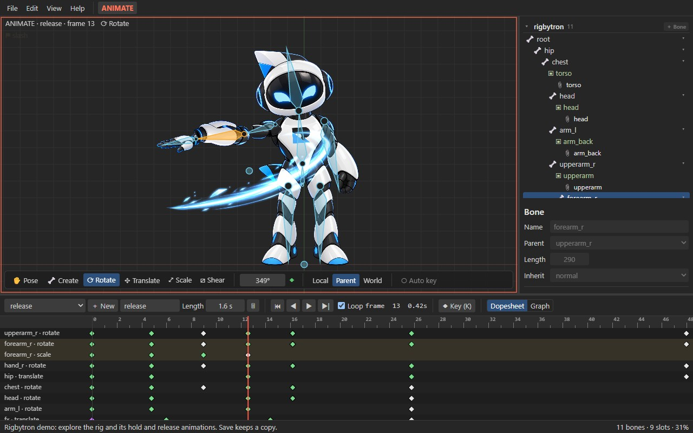

<p align="center">
  
</p>

<h1 align="center">Rigby2D</h1>

<p align="center">
  <strong>Open-source 2D skeletal animation editor for games.</strong><br>
  Import your art, draw bones, keyframe animations, export JSON + a texture atlas.
</p>

<p align="center">
  <a href="LICENSE"></a>
  
  
  
  <a href="CONTRIBUTING.md"></a>
</p>

<p align="center">
  
</p>

## Features

- **Art import**: PSD files (every pixel layer becomes a part, layout preserved) or individual PNGs.
- **Rigging**: draw bone chains directly in the viewport, reparent, attach images to bones, reorder draw order, turn images into meshes (add, move and delete vertices), bind meshes to bones and paint weights.
- **Constraints, skins and events**: create IK, transform, path, physics and slider constraints from the selected bones and edit every setting; key their mixes and values in Animate mode; create skins (with skin bones and constraints) and events with keyed values; add bounding box, clipping, point and path attachments.
- **Animation**: Setup and Animate modes, pose / rotate / translate / scale / shear tools, key buttons and optional auto key, switchable shortcut presets.
- **Dopesheet and graph editor**: multi-key selection, moving and retiming keys, curve presets, bezier handle editing, image-swap keys.
- **Undo / redo** for every edit, with unsaved-change tracking.
- **`.rigby` work file**: one self-contained file with the whole project and its images (like a `.blend`).
- **Skeleton import/export**: opens and exports the widely used skeleton formats: `.json` (3.8, 4.2, 4.3) and binary `.skel` (4.3), with `.atlas` texture atlases. Meshes, weights, skins, constraints, events, deform and draw-order keys round-trip losslessly.
- **Runtime included**: a small dependency-free JavaScript runtime (`src/core`) with animation tracks, events, image sequences, IK, transform, path, physics and slider constraints, plus a reference WebGL renderer (`src/webgl`).
- **Sample character**: *File ▸ New sample (robot)* gives you a rigged, animated character to explore.

## Getting started

### Prerequisites

- [Node.js](https://nodejs.org) 20 or newer
- Tauri's system prerequisites for your OS, see <https://tauri.app/start/prerequisites/>
  - **Windows:** Microsoft C++ Build Tools ("Desktop development with C++") and WebView2 (preinstalled on Windows 10/11)
  - **macOS:** Xcode Command Line Tools
  - **Linux:** WebKitGTK and build essentials

### Run

```bash
git clone https://github.com/jaisurya-dev-art/rigby2d.git
cd rigby2d
npm install
npm run dev
```

### Build a release

```bash
npm run build
```

The app is written to `src-tauri/target/release/` and the installer to `src-tauri/target/release/bundle/`.

### Test

```bash
npm test
```

## Using Rigby2D

1. **Import art:** *File ▸ Import PSD…* or *File ▸ Import PNG images…*
2. **Draw bones:** pick the *Create* tool in the viewport toolbar and drag. Select a bone first to chain children from it.
3. **Attach images:** select an image and choose its *Bone* in the inspector.
4. **Animate:** switch to Animate mode, move the time cursor and pose bones, then set keys with the key buttons (or turn on *Auto key*). The *Help* menu lists the keyboard shortcuts.
5. **Save:** *File ▸ Save* writes your work file `name.rigby`. Reopen it any time with *File ▸ Open*.
6. **Export:** *File ▸ Export JSON + atlas…* or *Export .skel + atlas* writes the skeleton plus `name.atlas` and `name.png` for game runtimes. *File ▸ Open* also imports existing `.json` / `.skel` exports.

## Playing animations in your game

Copy `src/core/` into your project (no dependencies). With WebGL, also copy `src/webgl/` for a
ready-made renderer (one batched draw call per texture and blend mode, two-color tint, clipping):

```js
import { AnimationState, Pose, parseAtlas, readSkeletonJson } from './core/index.js';
import { WebGLRenderer } from './webgl/renderer.js';

const { skeleton } = readSkeletonJson(JSON.parse(jsonText), 'hero'); // hero.json
const pose = new Pose(skeleton);
const state = new AnimationState();
state.play(skeleton, 'walk', true, 0.2);              // track 0, 0.2 s crossfade
state.setAnimation(skeleton, 1, 'shoot', false, 0.1); // track 1 layers on top
state.addAnimation(skeleton, 0, 'idle', true, 0.3);   // queued after walk
state.addListener({ event: (entry, e) => playSound(e.audio ?? e.name) });

const renderer = new WebGLRenderer(gl);
const textures = renderer.atlasTextures(parseAtlas(atlasText), { 'hero.png': pageImage });

function frame(dt) {
  state.update(skeleton, dt);
  state.apply(skeleton, pose);
  renderer.begin(canvas.width, canvas.height, { x: 0, y: 200, zoom: 1 });
  renderer.drawSkeleton(skeleton, pose, textures);
  renderer.end();
}
```

With another renderer, draw `pose.quads(skeleton)`: world-space positions (Y up), UVs, tint and
blend mode for every visible region and mesh. `examples/webgl.html` is a small player: run
`npm run web:dev` and open `/examples/webgl.html`.

### File formats

- **`.rigby`**: Rigby2D's work file: a ZIP holding `project.json` (the complete document) and
  `images/*.png`. Use it for saving work in progress.
- **Skeleton `.json` / `.skel`**: the interchange formats game runtimes load. Bones are listed so
  parents come first, slots are in draw order, attachments live in skins, and animations hold bone,
  slot, deform, draw-order, IK and event timelines with keys relative to the setup pose. Images
  come from a `.atlas` texture atlas or loose files in the skeleton's `images` folder.
- Binary `.skel` support covers format 4.3 skeletons with IK, transform, path, physics and
  slider constraints, skins, region and mesh attachments with image sequences, linked mesh,
  bounding box, path and clipping attachments, and bone, slot, IK, transform, path, physics,
  slider, deform, sequence, draw-order and event keys. Rigs using other features (point
  attachments, separate RGB/alpha color keys, …) export to `.json` instead.
- The runtime evaluates IK, transform, path, physics and slider constraints and plays image
  sequences (hold, once, loop, ping-pong and reverse modes). Physics uses Rigby2D's own
  spring model driven by the stored settings (inertia, strength, damping, mass, wind, gravity,
  limit, mix), so motion can differ slightly from other tools. It simulates while animations play
  (`AnimationState` passes the elapsed time); `pose.resetPhysics()` starts it over.

## Performance benchmark (0.1.0)

Measured on a desktop PC in Chromium and Node 20; numbers vary with hardware. Rigs are described
by size: **M** has 67 bones and 276 mesh vertices, **L** 76 bones and 667 weighted mesh vertices
with 9 IK constraints, **XL** 143 bones and 879 mesh vertices with 21 transform and path
constraints.

**Runtime** (`src/core`): animating one character for one frame (apply the animation, solve
constraints, compute world transforms and vertices), median of 2000 frames:

| Rig | Time per frame | Characters per 16 ms frame |
| --- | ---: | ---: |
| M | 47 µs | ~330 |
| L | 72 µs | ~220 |
| XL | 184 µs | ~85 |

**WebGL renderer** (`src/webgl`): 50 XL characters, each animated and drawn every frame, take
21.6 ms per frame including the GPU (0.43 ms per character) in a single draw call.

**Editor viewport**: drawing one animation frame with WebGL, median and 95th percentile of 120
frames:

| Rig | Median | 95th percentile |
| --- | ---: | ---: |
| M | 0.4 ms | 0.5 ms |
| L | 0.5 ms | 0.7 ms |
| XL | 1.0 ms | 1.6 ms |

## Project structure

```
src/core/       Runtime: data model, skeleton JSON/.skel + atlas I/O, pose evaluation, constraints, playback
src/editor/     Editor UI: viewport, tree, properties, dopesheet, graph editor, import/export
src/webgl/      Reference WebGL renderer for the runtime
examples/       WebGL player example
src-tauri/      Native desktop shell (window + file dialog/fs plugins only)
test/           node:test suites
docs/           Logo and screenshots
```

## Contributing

Contributions are welcome! Please read [CONTRIBUTING.md](CONTRIBUTING.md) for the development setup,
coding style and pull request process.

## License

[MIT](LICENSE) © 2026 [jaisurya-dev-art](https://github.com/jaisurya-dev-art)

## Disclaimer

Rigby2D is an independent open-source project. It is not affiliated with, endorsed by, or sponsored by the makers of any other animation software. All trademarks belong to their respective owners.

Rigby2D reads and writes the skeleton JSON, binary `.skel` and texture atlas file formats solely for interoperability, so that users can work with their own exported files. This support was implemented clean-room:

- **JSON and atlas formats:** implemented from publicly available documentation.
- **Binary `.skel` format:** implemented from the publicly documented binary layout of earlier versions and by comparing JSON and binary exports of the same skeleton (black-box observation of exported data).

No third-party source code, runtimes, editor files or assets are used or distributed with Rigby2D. Compatibility with files from any particular editor or runtime version is provided as-is and is not guaranteed.
