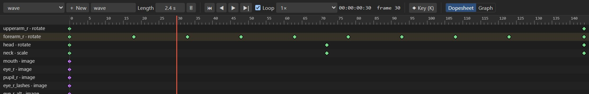

# Animating

Animations change the rig over time: bone transforms, image swaps, colors, mesh deformation,
constraint values, draw order and events. Each is stored as keys relative to the setup pose, so
animations work on any skin and can be layered in games.

## Animations

| To | Do |
| --- | --- |
| Create an animation | **+ New** in the timeline. You switch to Animate mode. |
| Choose one | The animation menu at the left of the timeline. |
| Rename it | Edit the name field next to **+ New**. |
| Set its length | **Length** (seconds). Keys after the end make it longer. |
| Delete it | The 🗑 button. |

The frame rate is a project setting (Project panel, **Frame rate**); keys snap to its frames.

## Setting keys

Switch to **Animate mode** (<kbd>Tab</kbd>), move the time cursor, change the pose, and key it.

| Command | Default key | Keys |
| --- | --- | --- |
| **◆ Key** (timeline) | | Everything about the selection: all transforms of the selected bones, or a slot's image. |
| *Key changed properties* | <kbd>K</kbd> | Every change you made that is not keyed yet. |
| *Key the current tool's property* | <kbd>L</kbd> | Rotation with the Rotate tool, position with Translate, and so on. |
| *Key all transforms of the selection* | <kbd>Ctrl</kbd>+<kbd>L</kbd> | Rotate, translate, scale and shear of the selected bones. |
| *Key everything shown* | <kbd>Ctrl</kbd>+<kbd>Shift</kbd>+<kbd>L</kbd> | Every bone channel in the dopesheet at the current frame, plus unkeyed changes. |
| **◆** next to a value | | That value. |

**Auto key** in the viewport toolbar keys every change right away.

Without auto key, changes you have not keyed are kept on screen until you key them, or until the
time, the animation or the mode changes; then they are discarded and the status bar says so. Key
buttons show the state: keyed at this frame, changed but not keyed, or not keyed.

### Image swaps and colors

- **Images**: pick another attachment for a slot (in the inspector, or by clicking it in the tree)
  to set an image-swap key. Swaps are stepped: the image changes exactly on the key.
- **Colors**: change a slot's tint in Animate mode and key it.
- **Mesh shapes**: see [Deforming in Animate mode](meshes.md#deforming-in-animate-mode).
- **Constraints**: select a constraint; its mixes and values have key buttons. See
  [Constraints](constraints.md).
- **Events**: see [Keying events](skins-and-events.md#keying-events).

## Playback

| Control | Does |
| --- | --- |
| ⏮ | First frame (<kbd>Q</kbd>). |
| ◀ / ▶\| | Previous / next frame (<kbd>F</kbd> / <kbd>R</kbd>, or the arrow keys). <kbd>Shift</kbd> moves 10 frames. |
| ▶ | Play and stop (<kbd>Space</kbd>). <kbd>A</kbd> plays backward. |
| **Loop** | Play the animation in a loop (<kbd>Ctrl</kbd>+<kbd>R</kbd>). |
| Speed | 0.1× to 2× playback speed, for checking timing. |
| Time | Frame and seconds, or timecode and frame in the Film workspace. |

<kbd>W</kbd> and <kbd>S</kbd> jump to the next and previous key; <kbd>E</kbd> to the last key.
Keys are listed for the *Reference* preset; see [Keyboard shortcuts](shortcuts.md).

Physics and audio play with the timeline. Editing while playing is allowed and marks the project as
changed.

## The dopesheet

The dopesheet shows a row for every keyed channel of the animation: each bone's rotate, translate,
scale and shear, slot images and colors, mesh deformation, image sequences, IK and other constraints,
draw order and events. Diamonds are keys; their color tells the curve (stepped keys are purple).

| To | Do |
| --- | --- |
| Move the time cursor | Click or drag in the ruler or an empty area. |
| Select a key | Click it. <kbd>Ctrl</kbd>+click adds to the selection. |
| Select several | Drag a box around them. |
| Move keys | Drag a selected key; the others move with it. |
| Retime keys | Drag the handles at the edges of the selection in the ruler: the keys stretch or squeeze relative to the opposite edge. |
| Change the curve | Right-click a key: *Linear*, *Ease in-out*, *Ease in*, *Ease out* or *Stepped*. |
| Delete keys | Right-click ▸ *Delete key*, or <kbd>Delete</kbd>. |

Keys always land on whole frames.

## Curves

Each key has a curve that shapes the motion to the next key:

| Curve | Motion |
| --- | --- |
| **Linear** | Constant speed. Mechanical. |
| **Ease in-out** | Slow out of the key, fast in the middle, slow into the next. The natural default for most motion. |
| **Ease in** | Starts slowly, ends fast: falling, swinging into a hit. |
| **Ease out** | Starts fast, ends slowly: settling, landing. |
| **Stepped** | Holds the value until the next key: snappy timing, image swaps. |
| **Custom** | Any Bézier shape, set in the [graph editor](graph-editor.md). |

## Tips for good motion

- **Block first, then refine.** Key the main poses with stepped curves, check the timing, then
  switch to eased curves and add breakdowns.
- **Overlap.** Let the head, hands and hair arrive a few frames after the body. Shift their keys in
  the dopesheet, or let [physics](constraints.md#physics) do it for hair and accessories.
- **Use the graph editor** to fix pops and floaty motion: see [Graph editor](graph-editor.md).
- **Use onion skin** to check arcs and spacing: see [Onion skin](onion-skin.md).
- **Save poses** you reuse, such as expressions and hand shapes: see
  [Poses and face controls](poses-and-faces.md).
