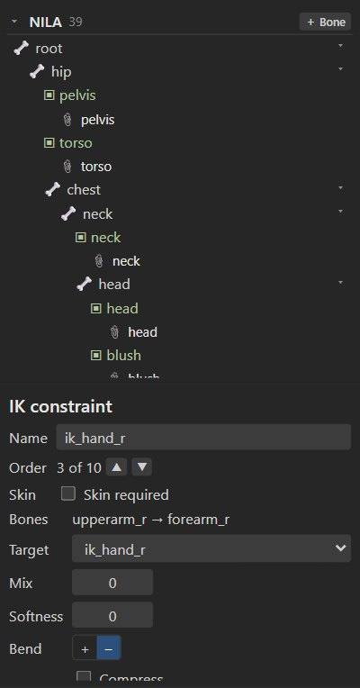
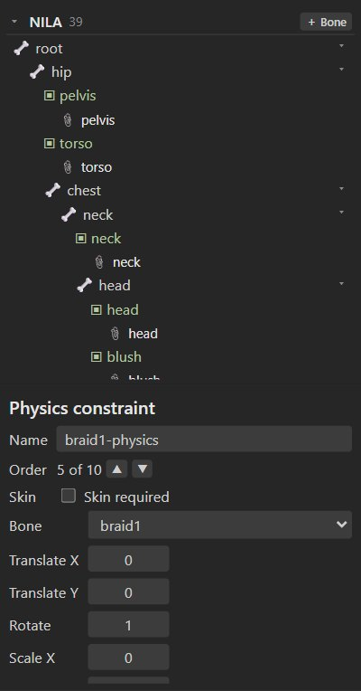

# Constraints

Constraints move bones for you. Rigby2D has five kinds, all evaluated by the editor and by every
runtime:

| Constraint | Does | Typical use |
| --- | --- | --- |
| [**IK**](#ik) | Bends a chain of one or two bones so its tip reaches a target bone. | Arms reaching, feet planted on the ground. |
| [**Transform**](#transform) | Copies (or adds) a source bone's rotation, position, scale or shear to other bones. | Gears, mirrored parts, a jaw following a chin control. |
| [**Path**](#path) | Places and rotates bones along a path attachment. | Tails, ropes, tentacles, objects following a track. |
| [**Physics**](#physics) | Simulates springy follow-through on bones. | Hair, braids, earrings, cloth, antennae. |
| [**Slider**](#slider) | Plays an animation at a time set by a value or by a bone. | Facial rigs, dials, a bone that "scrubs" a pose. |

## Creating a constraint

1. In Setup mode, select the bones as the constraint needs them (below).
2. In the tree's **Constraints** section, press **+** and choose the kind.
3. Adjust the settings in the inspector.

Every constraint has a **Name**, a **Mix** (how much it applies, 0 to 1), an **Order** (*Apply
earlier* / *Apply later*: constraints apply one after another) and **Skin required** (active only when
the current skin includes it; see [Skins](skins-and-events.md#skin-bones-and-constraints)).

In **Animate mode**, selecting a constraint shows its keyable values instead (mixes, IK bend,
path position and spacing, physics strength and wind, slider time) with **◆** key buttons. Keys
appear in the dopesheet.

## IK

Select 1 or 2 bones for the chain, then optionally the target bone, and create an IK constraint. With
no target selected, a new bone is added at the tip of the chain to act as the target. Move the target
and the chain follows.

| Setting | Meaning |
| --- | --- |
| **Bones** | The chain (1 or 2 bones). *Use selected bones as chain* replaces it with the selection. |
| **Target** | The bone the chain reaches for. |
| **Mix** | 0 = the animated pose, 1 = fully solved by IK. |
| **Softness** | Distance before full reach where the chain starts slowing, so a straightening arm or leg does not snap. |
| **Bend** | The direction the middle joint bends. Flip it if an elbow or knee bends the wrong way. |
| **Compress** | Scale the bones down when the target is closer than their length. |
| **Stretch** | Scale the bones up when the target is farther than their length. |
| **Uniform** | Compress and stretch scale both axes. |

> [!TIP]
> For walk cycles, key the foot targets, not the leg bones: feet stay planted while the hips move.
> AutoRig adds IK targets (`ik_foot_l`, `ik_hand_r`, …) for every two-bone limb.

## Transform

Select the bones to constrain, then the **source** bone last.

| Setting | Meaning |
| --- | --- |
| **Bones**, **Source** | The constrained bones and the bone they read from. |
| **Local source** | Read the source bone in its parent's space. |
| **Local target** | Change the constrained bones in their parent's space. |
| **Additive** | Add the source's values instead of matching them. |
| **Clamp** | Limit mapped values to each mapping's range. |
| **Properties** | Which of *Rotate*, *X*, *Y*, *Scale X*, *Scale Y* and *Shear Y* are copied, each with an **Offset** and a **Mix**. |
| **Property mapping** | Advanced: let one source property drive another target property (*Source → target*) with an **Offset**, **Scale** and **Max**. For example, the source's rotation can move the target along X. |

**Offsets from current pose** sets the offsets so the constrained bone stays where it is now in the
setup pose.

## Path

Add a [path attachment](bones-and-slots.md#attachments) first, or let the constraint make one: select
the bones to place along the path and create a path constraint. A new path through the bones'
origins and the last bone's tip is added.

| Setting | Meaning |
| --- | --- |
| **Path slot** | The slot whose path the bones follow. |
| **Position** | *Fixed* (in world units) or *Percent* (of the path length), with **Position value**. Key the value to slide the bones along the path. |
| **Spacing** | *Length* (each bone's length), *Fixed*, *Percent* or *Proportional*, with **Spacing value**. |
| **Rotate** | *Tangent* (along the path), *Chain* (point at the next bone) or *Chain scale* (also stretch to reach it). |
| **Rotation offset** | Added rotation. |
| **Mix rotate**, **Mix X**, **Mix Y** | How much of the rotation and position the path controls. |

## Physics

Select the bones that should move with physics and create a physics constraint. Each bone gets one.
Physics adds motion the animation does not have: when the head turns, a braid swings past, overshoots
and settles.

| Setting | Meaning |
| --- | --- |
| **Bone** | The simulated bone. |
| **Translate X**, **Translate Y**, **Rotate**, **Scale X**, **Shear X** | Which motions are simulated, and how strongly (0 to 1). Braids and earrings usually only need *Rotate*. |
| **Limit** | The fastest speed the simulation lets a bone move, so fast animation cannot fling it away. |
| **Step** | Simulation rate (60 fps by default). |
| **Inertia** | How much of the parent's motion the bone resists (0 to 1). |
| **Strength** | How strongly it springs back to the animated pose. |
| **Damping** | How quickly the swinging dies down (0 to 1). |
| **Mass** | Heavier bones swing more slowly. |
| **Wind**, **Gravity** | Constant forces. |
| **Mix** | How much of the simulation is applied. |

**Global** next to a value makes it also follow skeleton-wide physics keys, so one key can change the
wind or gravity for every physics constraint at once.

Physics runs while an animation plays (in the editor, in renders and in the runtimes) and restarts
from the animated pose when playback starts. Renders simulate frame by frame from the start of the
animation, so they are repeatable.

> [!NOTE]
> Rigby2D's physics uses its own spring model driven by these settings, so the motion can differ
> slightly from other tools that read the same files.

## Slider

A slider plays an animation at a time you set. Create one when the project has an animation to
drive.

| Setting | Meaning |
| --- | --- |
| **Animation** | The animation it applies. |
| **Time** | Where in the animation (seconds). Key it to scrub the animation from another animation. |
| **Mix** | How much is applied. |
| **Loop** | Wrap the time around the animation's length. |
| **Additive** | Add the animation on top instead of replacing the pose. |
| **Bone** | Optional: drive the time from a bone. With a bone set, **Property** (rotation, X, Y, scale or shear) times **Scale** gives the time; **Local** reads it in the parent bone's space. |

For example, make an animation `smile` that goes from neutral (time 0) to a full smile (time 1), add
a slider for it, and set **Bone** to a `smile_ctrl` bone with *Y* × 0.01: moving the control up 100
units smiles fully.

## Through the runtimes

The JavaScript and Rust runtimes evaluate all five constraint types with their keys. See
[Runtimes](runtimes.md). Binary `.skel` export supports all of them; see [Export](export.md).
