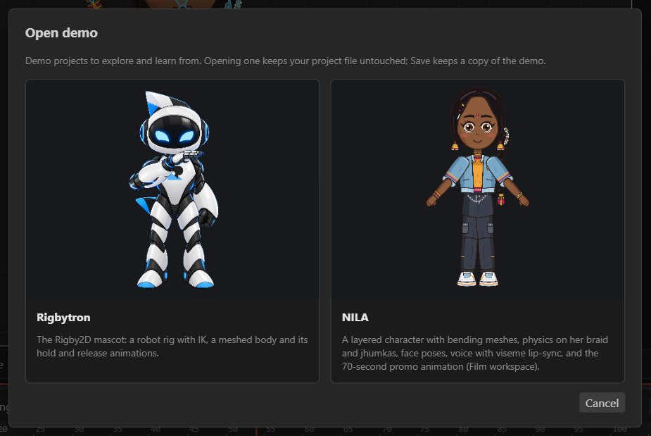
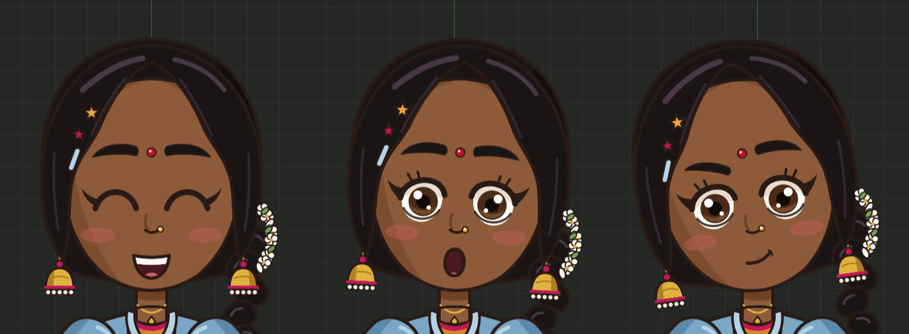

# Demo projects

*File ▸ Open demo…* lists the bundled demo projects. Click a card to open it, playing. Opening a demo
does not touch your files; *Save* keeps a copy.

| Demo | Shows |
| --- | --- |
| **NILA** | A layered character with bending meshes, IK, physics on her braid, earrings and jasmine, face poses (Happy, Surprised, Thinking) with a *Mood* face control, her voiceover with viseme lip-sync, and the 70-second promo film in the Film workspace. Animations: `idle`, `wave`, `promo`. |
| **Rigbytron** | The Rigby2D robot mascot: a rig with a meshed body and its `hold` and `release` animations, with a `slash` event. |

NILA and Rigbytron are proprietary characters of Hoverlabs: use them to learn and explore, but not
in your own products. See [TRADEMARKS.md](../TRADEMARKS.md).
