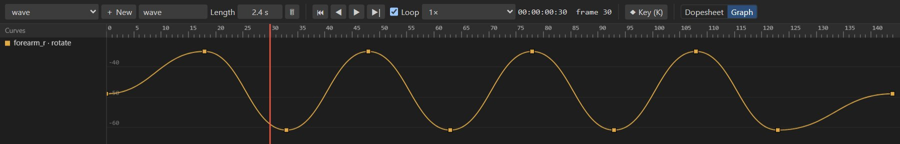

# Graph editor

The graph editor shows the animation's bone channels as curves of value over time, with draggable
keys and Bézier handles. Use it to shape easing precisely, fix pops and see the rhythm of a motion.
Switch to it with **Graph** at the right of the timeline controls.

## What it shows

- A curve per keyed bone channel of the selected bones (all keyed bones when none is selected):
  rotate, and the X and Y parts of translate, scale and shear.
- Keys are dots on the curves; the selected key shows its Bézier handles.
- The channel list on the left: click a channel to hide or show its curve.

## Navigating

| To | Do |
| --- | --- |
| Zoom the values | Mouse wheel over the graph. |
| Pan the values | <kbd>Shift</kbd>+wheel. |
| Zoom time | <kbd>Ctrl</kbd>+wheel, around the cursor. |
| Pan time | <kbd>Alt</kbd>+wheel. |
| Fit everything | Double-click. |
| Move the time cursor | Click or drag in the ruler. |

The time range is the whole animation until you zoom or pan it.

## Editing curves

| To | Do |
| --- | --- |
| Select a key | Click it. <kbd>Ctrl</kbd>+click adds to the selection. |
| Move keys | Drag them: left and right changes time, up and down changes value. Hold <kbd>Shift</kbd> to move along one axis only. |
| Shape the curve | Drag a key's Bézier handles. The opposite handle mirrors the slope, so the motion stays smooth through the key. |
| Break the handles | Hold <kbd>Alt</kbd> while dragging a handle to move it on its own, for a sharp change of direction (a bounce, a hit). |
| Set a preset curve | Right-click: *Linear*, *Ease in-out*, *Ease in*, *Ease out*, *Stepped*. |

Curves are stored per segment as a cubic Bézier between two keys (as in CSS `cubic-bezier()`), which
is what the skeleton formats and runtimes use, so what you see is what games play.

## Reading curves

| Shape | Means |
| --- | --- |
| Flat | The value holds. |
| Steep | Fast change. |
| S-shape | Ease in and out: slow, fast, slow. |
| Sharp corner | An abrupt change of direction: intentional for impacts, a pop otherwise. |
| Overshoot past the next key's value | The motion goes past and comes back: good for settling, a bug if unintended. |

> [!TIP]
> Fix a "floaty" motion by making the curve steeper in the middle, and a "mechanical" one by easing
> into and out of the keys.
