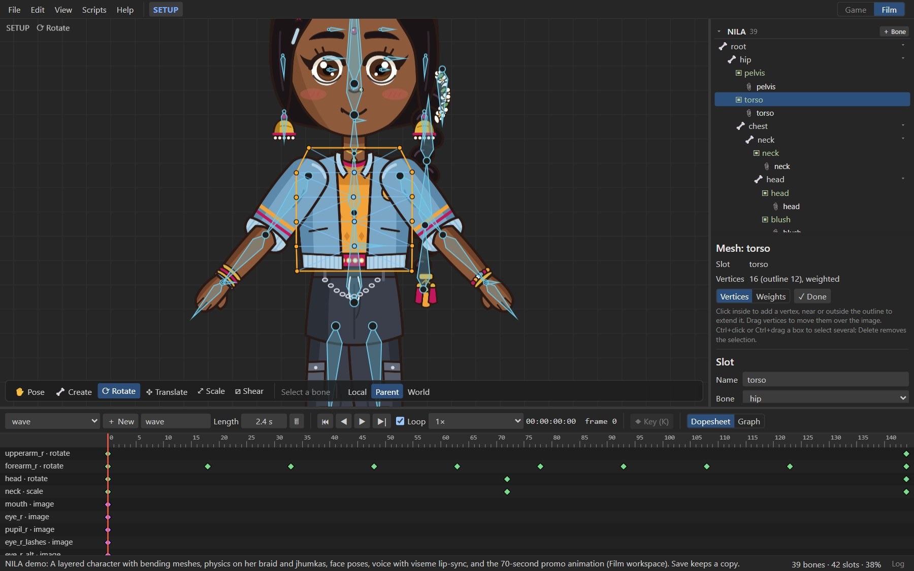
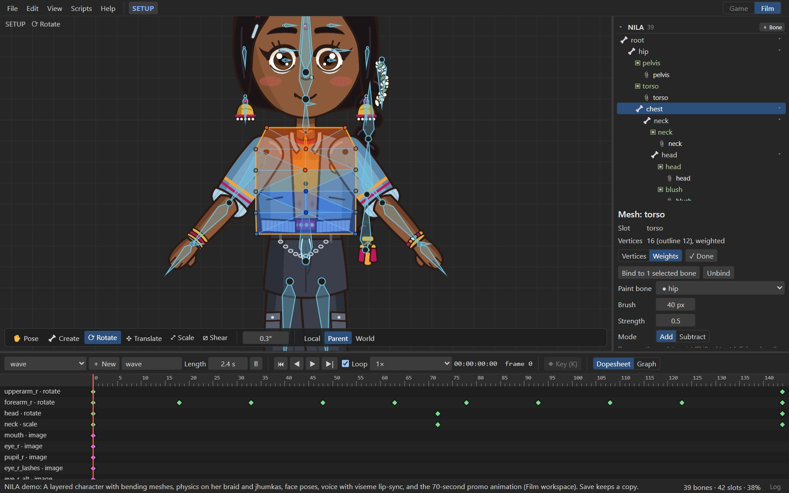

# Meshes

A mesh is an image with vertices. Meshes bend: bind one to several bones and each vertex follows them
by its weights, so a sleeve bends at the elbow, a torso twists and a tail curls. In Animate mode, you
can also move vertices directly and key the shape (deform keys).

## Turning an image into a mesh

1. In Setup mode, select the image's slot.
2. Press **▦ Convert to mesh** in the inspector. The image is replaced by a mesh with four vertices
   at its corners, and mesh editing starts.
3. Click to add vertices: around the visible shape of the image to outline it, and inside where it
   should bend. **✎ Edit mesh** edits it again later.

AutoRig makes meshes for bending parts by itself.

## Editing vertices

With **Vertices** selected in the mesh panel:

| To | Do |
| --- | --- |
| Add a vertex inside | Click inside the mesh. |
| Extend the outline | Click near or outside the outline. |
| Move vertices | Drag them over the image. |
| Select several | <kbd>Ctrl</kbd>+click, or <kbd>Ctrl</kbd>+drag a box. |
| Delete | Select and press <kbd>Delete</kbd>. |

The mesh panel shows the vertex count (outline and inner) and whether it is weighted. Rigby2D
triangulates the mesh for you. Put vertices where the image should bend: rows across a joint bend
smoothly, and few vertices elsewhere keep the mesh light.

**✓ Done** finishes editing.

## Weights

A weighted mesh follows several bones. Each vertex has a weight per bone, and the weights of a vertex
add up to 1.

1. Select the bones the mesh should follow: <kbd>Ctrl</kbd>+click them in the tree.
2. Press **Bind to N selected bones**. Each vertex is weighted to the nearest of those bones.
3. Switch to **Weights** to refine them by painting.

| Setting | Meaning |
| --- | --- |
| **Paint bone** | The bone you are painting weight for. ● marks bones the mesh uses. |
| **Brush** | Brush radius in pixels. |
| **Strength** | How much one stroke changes the weight. |
| **Mode** | *Add* or *Subtract* (hold <kbd>Shift</kbd> to subtract while painting). |

Drag over the mesh to paint. Colors show the paint bone's weight: red is full weight, blue none.
**Unbind** removes the weights; the mesh then follows its slot's bone only.

> [!TIP]
> Check weights by rotating the bones in Animate mode, then undo. A crease at a joint means the
> weights change too suddenly across it: paint a softer blend over two or three rows of vertices.

## Deforming in Animate mode

In Animate mode, **✎ Deform mesh** lets you move vertices over time:

- Drag vertices to key their positions at the current frame; drag a box (or <kbd>Ctrl</kbd>+click)
  to select several and move them together.
- Keys appear in the dopesheet as the slot's **deform** row.

Deform keys add to what the bones do, so you can squash a face for a blink, bulge a cheek or wobble a
belly on top of the skeletal animation.

## Linked meshes

A linked mesh shows another image with the same vertices, triangles and weights as a mesh. Use it for
alternate drawings of a bending part, such as a sleeve in another color for a different outfit.

On a mesh, choose an image in **＋ Linked mesh with image…**. *Use the deform keys of the parent mesh*
decides whether it also follows the mesh's deform keys. Edit the parent mesh; the linked ones follow.

## Image sequences on meshes

Meshes can play numbered image sequences. See [Image sequences](bones-and-slots.md#image-sequences).
