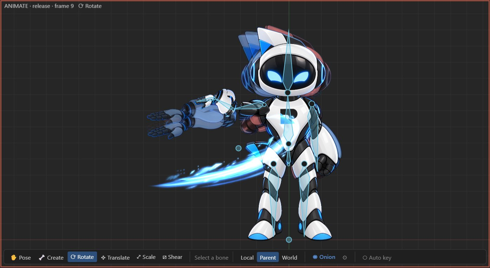

# Onion skin

Onion skinning draws the frames before and after the current one as tinted ghosts behind the pose,
so you can see arcs, spacing and timing while you animate. It works in Animate mode.

## Turning it on

Press **Onion** in the viewport toolbar (Animate mode). The **⚙** button next to it opens the
settings:

| Setting | Meaning |
| --- | --- |
| **Show past**, **Show future** | Which side to draw. |
| **Past frames**, **Future frames** | How many ghosts on each side. |
| **Past color**, **Future color** | Their tint (red and blue by default; reset with the button next to each). |
| **Spacing (frames)** | Frames between ghosts: 1 draws every frame; more spreads the ghosts out, useful at high frame rates. |
| **Loop** | For looping animations, wrap around: ghosts near the end show the start. |

## Only some bones

By default the whole skeleton is ghosted. To focus on one limb, use the onion button of a bone in the
tree and tick **Show on this bone (and its children)**. Once any bone has its own setting, only those
bones are ghosted. Each bone can override the frame counts and colors; blank values use the global
settings.

Per-bone settings follow the bone when it is renamed, and survive undo.

## Reading the ghosts

- **Even spacing** means even speed. Ghosts bunching up at the ends of a motion show easing.
- **A ghost that jumps** away from its neighbors means a pop: check the curve in the
  [graph editor](graph-editor.md).
- **Arcs**: hands, heads and tails should move along arcs. Straight ghost trails look mechanical.
