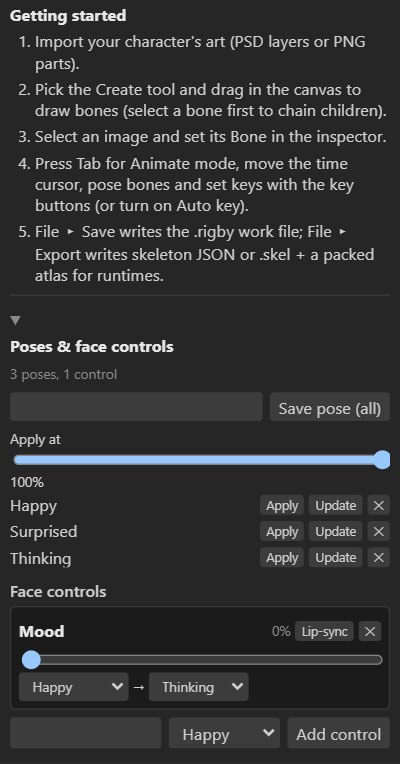

# Poses and face controls

The **pose library** stores poses you reuse: expressions, hand shapes, mouth shapes, a character's
idle stance. **Face controls** are sliders that blend between poses, so a single slider takes a face
from happy to thinking. Both live at the bottom of the inspector, in **Poses & face controls**.

## The pose library

### Saving a pose

1. Pose the character. Select the bones the pose is about (for a face: the head, brows, eyes,
   pupils and mouth), or select nothing to save every bone.
2. Type a name and press **Save pose** (**Save pose (all)** with nothing selected).

A pose stores the bones' transforms **and the images their slots show**, so mouth shapes, eyes
closed or open, and hand drawings are part of it.

### Using a pose

| Button | Does |
| --- | --- |
| **Apply** | Puts the pose on the rig, at the **Apply at** amount (0 to 100%). In Setup mode it changes the setup pose; in Animate mode it sets keys at the current frame. |
| **Update** | Replaces the pose with the current pose of the same bones. |
| **✕** | Deletes the pose. |

Applying at less than 100% blends from the current pose toward the saved one: a half smile, a
slight lean.

## Face controls

Face controls are sliders (in the Film workspace) that blend from one pose to another. Use them to
build a face rig: *Brows up*, *Eyes closed*, *Mouth open*, or a *Mood* slider from happy to thinking.

### Adding a control

Save the poses first. Then, under **Face controls**, type a name, choose the pose it blends to, and
press **Add control**. A control blends from the setup pose to its pose; choose a **from** pose to
blend between two poses instead (NILA's *Mood* goes from *Happy* to *Thinking*).

### Using a control

- In **Setup mode**, dragging the slider blends the setup pose.
- In **Animate mode**, dragging the slider keys the blend at the current frame.

Rotations take the short way round, and image swaps switch at the halfway point, so eyes close and
mouths change cleanly in the middle of a blend.

### Lip-sync from loudness

Each control has a **Lip-sync** button: it keys the control on every frame from the loudness of the
animation's first audio track. A *Mouth open* control then opens on speech and closes in silence.
For mouth shapes per sound, use [viseme lip-sync](lip-sync.md) instead.

## Poses in exports

Poses and face controls are editing tools: they are saved in the `.rigby` file but not in skeleton
exports. What they produce (keys and image swaps) is ordinary animation data, so it exports and plays
in every runtime.

## Through MCP

`save_pose`, `apply_pose`, `delete_pose`, `add_face_control`, `set_face_control` and
`delete_face_control` work on `.rigby` files. See the [MCP tools](mcp-tools.md).
