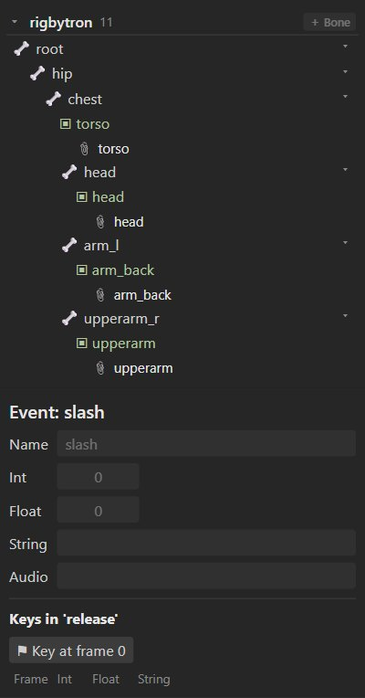

# Skins and events

## Skins

A skin is a set of attachments that can be swapped as a whole: outfits, armor sets, color variants,
or several characters sharing one skeleton and its animations. The same animation plays on every
skin.

### How skins work

- The **default** skin holds every attachment that is not in a named skin. Attachments added while
  the default skin is active belong to every skin.
- A **named skin** adds attachments by slot and name. When a game shows skin `knight`, a slot
  looking for its attachment `helmet` finds the knight's helmet.
- Animations refer to attachments by name, so an animation that swaps `hand` to `hand_fist` works
  with every skin that has those names.

### Creating and filling a skin

1. In the tree's **Skins** section, press **＋ New**. The new skin becomes active.
2. Select a slot and add images or shapes (**＋ Add image to skin '…'** in the inspector). They go
   into the active skin. Slots show skin attachments with the skin's name in brackets.
3. Click a skin in the tree to make it active and see what it contains.

| Setting | Meaning |
| --- | --- |
| **Name** | The skin's name, as games refer to it. |
| **Active** | Which skin the editor shows. **Make active** switches. |
| **Attachments** | How many attachments it has; **Attachments by slot** lists them. |
| **Bones** | Bones marked "skin required" that this skin turns on (**Use selected**). |
| **Constraints** | Constraints marked "skin required" that this skin turns on. |
| **Duplicate** | A copy of the skin to make a variant from. |

### Skin bones and constraints

Some bones and constraints only make sense for some skins: a cape bone with physics for the knight,
a tail for the cat. Mark them **Skin required**, then add them to the skins that use them. In other
skins they do nothing.

### Skins when rendering

*File ▸ Render animation* lists the skins: tick several to render each animation with each skin in
one batch. See [Film](film.md#rendering).

## Events

An event is a named moment in an animation that a game reacts to: a footstep sound, a hit frame, a
particle burst. Events carry optional values.



### Creating an event

In the tree's **Events** section, press **+**. Select it to set its default values:

| Setting | Meaning |
| --- | --- |
| **Name** | What the game listens for. |
| **Int**, **Float**, **String** | Values passed to the game. |
| **Audio** | The path of a sound to play. |
| **Volume**, **Balance** | How to play it (balance: −1 left to 1 right). |

### Keying events

Switch to Animate mode, choose the animation, go to the frame, select the event and press
**⚑ Key at frame N**. Each key can override the values above. **Keys** lists the event's keys in the current
animation; **Delete this key** removes one. Event keys also appear in the dopesheet.

### In the runtimes

```js
state.addListener({
  event: (entry, e) => {
    if (e.name === 'footstep') playSound(e.audio ?? 'step.wav', e.volume);
  },
});
```

See [Runtimes](runtimes.md#events).
